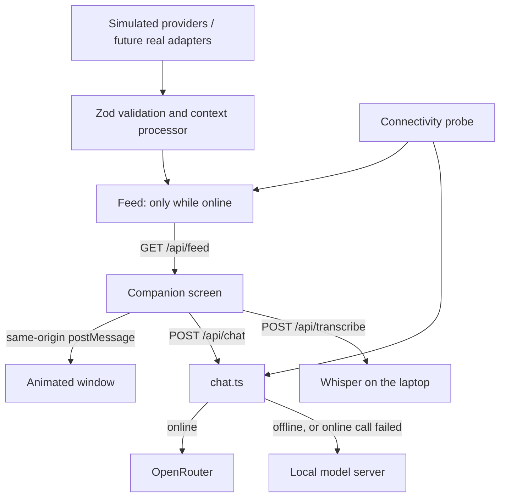

# Multi-hazard context pipeline

Implemented scope: five synthetic sources feeding the animation studio through a validated shared JSON contract. No external API is connected. No local model, notifications or dispatch are invoked.

## Flow

`SourceAdapter.read → BatchSchema + RecordSchema → processor → EventContextSchema → /v2/context → scene / weather:context event / AI harness`

The v2 flood adapter reuses the original flood model (`src/scenario.ts`) for weather observations/forecasts and river values so shared metrics stay consistent. Additional historical river values are synthetic. (The original `/v1/*` flood API and its dashboard were removed when the desktop app moved to `/companion`.)

## Endpoint and clock

`GET /v2/context?hazard=fire&seconds=200`

Hazards: `flood`, `fire`, `earthquake`, `outage`, `heat`. Seconds: 0–300. Omit seconds to use the feed's current position in the event stage. Stage boundaries are 100 and 200 seconds. Twelve simulated hours span five minutes, starting January 15, 2026 at midnight PST. Standalone studio playback advances its own scenario seconds; pause freezes it and replay returns to the selected stage's start. The UI polls every two seconds without restarting animations on unchanged stages. A failed or invalid context hides the scene and displays unavailable, not steady.

## Streams

| Scenario | Canonical metrics |
|---|---|
| Flood | Hourly rainfall, river level, gust, temperature, humidity |
| Wildfire | Temperature, humidity, gust, PM2.5, incident area, distance |
| Earthquake | Detected magnitude and shaking intensity; null before detection |
| Power outage | Affected-customer percentage, temperature |
| Heat | Temperature, humidity, heat index, gust |

The packet has latest readings, observed and forecast 1/4/8/12-hour windows, full normalized evidence, sources, assessment, quality dimensions, failure reports, scene state, and an AI handoff. No earthquake forecast, restoration estimate, or computed fire-spread forecast is generated. The fire animation is illustrative; distance and area metrics do not control its path.

## Replacement contract

Implement `SourceAdapter` exported by `src/event-pipeline.ts`:

```ts
const adapter: SourceAdapter = {
  source: { id: 'provider:regional-weather', name: 'Provider name',
    provenance: 'live', updateIntervalSeconds: 600 },
  async read({ hazard, asOf, areaId }) {
    // Fetch with provider-specific timeout/cache/rate limits.
    // Validate provider JSON. Convert units, resolve area, normalize timestamps.
    // Return { source: this.source, records: [...] } matching BatchSchema.
  }
};
const packet = await buildEventContext({hazard: 'heat', asOf, areaId,
  adapters: [adapter], assessor: yourEvidenceBasedAssessor});
```

This is an integration seam, not an existing production adapter. Implement provider authentication, HTTP timeouts, retries/backoff, caching and geographic selection in that adapter. Studio polling is not permission to poll a real provider every two seconds. Serve cached normalized data at the UI refresh rate.

Every record includes stable source identity, area ID, metric, canonical unit, observation/forecast kind, interval, issue/retrieval times, simulated/live provenance, and separate validity/geographic-fit/uncertainty dimensions. Null means unavailable, never zero. Percent metrics are bounded. Incorrect units, overlapping intervals and future-dated observations are rejected. A failing source produces a failure entry; the processor does not silently substitute synthetic records.

Multiple sources can supply different metrics. Competing providers for the same metric are rejected until an explicit priority/fusion policy is configured upstream, preventing double-counting. Regional and local records retain geographic-fit labels; the area resolver must establish whether a regional product applies to the requested location.

## Assessment boundary

Source adapters provide evidence. `Assessor` provides a stage, basis and evidence IDs. Without an assessor, stage is unknown. Live records are forbidden from using `scripted-fixture` assessment. Production thresholds, alert precedence, freshness requirements and notification rules require separately reviewed policies. The default synthetic assessor does not implement those policies.

Earthquake stage 2 is general readiness, never prediction. Stage 3 means an event was detected; the latest readings can be null after the event while the earlier event evidence remains available. No inference about building safety is made.

## Aggregation and quality

Rainfall sums interval amounts; gust and heat index use maxima; river/incident/outage state uses latest; temperature, humidity and PM2.5 use duration-weighted means. Overlaps are rejected. Windows include coverage hours and contributing evidence IDs. Partial values remain marked partial. No forecasts are used in observed windows. The current freshness summary uses a one-hour threshold; real adapters/assessors must introduce metric-specific freshness policy before operational use.

## Harness integration

Fetch the v2 packet directly or subscribe to `window.addEventListener('weather:context', e => consume(e.detail))` in the studio. Use schemaVersion and requestId/revision for routing and deduplication. The emitted packet is validated at the server boundary. AI evaluation is suggested, but notification authorization is false. Provider text is evidence, never instructions. Unknowns explicitly include building safety, individual exposure, dispatch and restoration time.

## Verification

Tests cover five hazards at stage boundaries, deterministic replay, evidence links, window coverage, aggregation, absent seismic forecasts, null readings, source failures, malformed units, overlapping records and preventing synthetic assessment of live inputs.

## Module ownership

- `src/events/schema.ts`: normalized contracts and unit registry.
- `src/events/simulation.ts`: synthetic provider adapters and fixture-only stage assessor.
- `src/events/processor.ts`: validation, source isolation, aggregation and handoff assembly.
- `src/event-pipeline.ts`: stable exports for consumers.
- `public/studio.js`: polling, scene consumption and browser handoff event.
- `samples/v2`: 15 sample packets plus exported JSON Schema.

## Companion screen (desktop app)

`/companion` is the app's only screen. It opens on the active emergency for `AGENT_SCENARIO` (always the event stage; no clock or playback) with a full-window alert, then shows: the emergency card (Live/Offline chip, readings, animated window), the assistant (full conversation, Help me now prompts, microphone, message box), the support contact (read-only from `data/profile.json`) and the scenario's official action card (verbatim official sentences from `data/cards/library-cards.json`, available without any model).

| Endpoint | Purpose |
|---|---|
| `GET /api/setup` | Scenario, online model setting, support contact, official card as steps, four prompts (`src/setup.ts`) |
| `GET /api/status` | `{internet, simulatedOffline, online, checkedAt, localReady}` (`src/connectivity.ts`) |
| `GET /api/feed` | `{packet, receivedAt}` while online; `503 {offline: true}` while offline (`src/feed.ts`) |
| `GET /api/feed?saved=1` | The packet regardless of connectivity: what the app shows if it starts without internet |
| `POST /api/simulate-offline` | `{offline: boolean}`: the hidden presenter key (Ctrl+Shift+O) |
| `POST /api/chat` | `{text, mode, context, history}` -> `{answer, provider, model, fallback}` |
| `POST /api/transcribe` | Raw 16 kHz mono float32 samples (max 30 s) -> `{text}` |
| `GET /v2/context` | Any hazard at any demo second (tests, debugging) |

### Online and offline

Connectivity is decided on the server: a HEAD request to the online model's server every 3 seconds (2 failures = offline, 1 success = online) plus the simulate-offline flag. The page combines that with `navigator.onLine` for an instant reaction when Wi-Fi is switched off.

- The feed (`src/feed.ts`) plays the event stage forward one simulated hour every 30 seconds, then holds (the flood's creek rises from 3.4 m to 4.2 m). It delivers packets only while online, so cutting the internet really stops updates. The page keeps the last packet and shows how old it is.
- Going offline: banner, grey card with "last update", frozen and dimmed scene, model badge "On this laptop", and a short note in the conversation. Coming back: "Back online. Updates resumed." and a fresh packet.

### Companion chat (shared agent)

`src/chat.ts` hands each question to `ask()` in the repo's `src/agent.ts` (meaning search over the 2,140-passage library, action cards on danger words, household profile, medical limit) and adds the companion's conversation style and the emergency packet as a "current situation" block, marked as possibly out of date when offline. Model choice: offline (server or page) always uses the local model; online uses `AGENT_PROVIDER`, and if that call fails or takes longer than 15 seconds the question is answered by the local model (`fallback: true`). The server keeps the local model loaded (`warmLocal()`). The OpenRouter key exists only in the server environment. No tools or autonomous actions are enabled.



### Dictation

The microphone button records at 16 kHz (Web Audio) and posts the samples to `/api/transcribe`; Whisper base.en runs on the laptop in a short-lived process (`src/transcribe.ts` in the repo root), and the words go into the message box to be checked before sending. Silence (which macOS sends when the app has no microphone permission) is reported instead of transcribed. Browser speech recognition is not used: in Electron it always fails, because it depends on Google's servers.

### Support contact and calls

The contact comes from the profile and is read-only. Its Call link opens the computer's calling app; nothing is dialled automatically. 911 is shown as text, never as a link.
