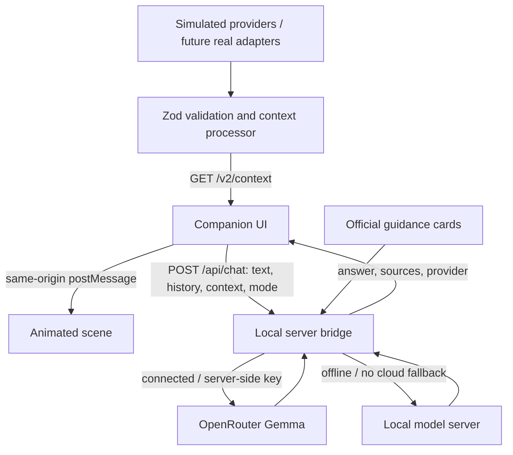

# Multi-hazard context pipeline

Implemented scope: five synthetic sources feeding the animation studio through a validated shared JSON contract. No external API is connected. No local model, notifications or dispatch are invoked.

## Flow

`SourceAdapter.read → BatchSchema + RecordSchema → processor → EventContextSchema → /v2/context → scene / weather:context event / AI harness`

The original `/v1/*` flood API remains compatible. The main dashboard still displays its v1 flood metrics. Its embedded scene also consumes v2 context. The v2 flood adapter reuses the original weather observations/forecasts and current river values so shared metrics remain consistent. Additional historical river values are synthetic.

## Endpoint and clock

`GET /v2/context?hazard=fire&seconds=200`

Hazards: `flood`, `fire`, `earthquake`, `outage`, `heat`. Seconds: 0–300. Omit seconds to use the existing server demo clock. Stage boundaries are 100 and 200 seconds. Twelve simulated hours span five minutes, starting January 15, 2026 at midnight PST. Standalone studio playback advances its own scenario seconds; pause freezes it and replay returns to the selected stage's start. The UI polls every two seconds without restarting animations on unchanged stages. A failed or invalid context hides the scene and displays unavailable, not steady.

## Streams

| Scenario | Canonical metrics |
|---|---|
| Flood | Hourly rainfall, river level, gust, temperature, humidity |
| Wildfire | Temperature, humidity, gust, PM2.5, incident area, distance |
| Earthquake | Detected magnitude and shaking intensity; null before detection |
| Power outage | Affected-customer percentage, temperature |
| Heat | Temperature, humidity, heat index, gust |

The packet has latest readings, observed and forecast 1/4/8/12-hour windows, full normalized evidence, sources, assessment, quality dimensions, failure reports, scene state, and an AI handoff. No earthquake forecast, restoration estimate, or computed fire-spread forecast is generated. The fire animation is illustrative; distance and area metrics do not control its path.

## Replacement contract

Implement `SourceAdapter` exported by `src/event-pipeline.ts`:

```ts
const adapter: SourceAdapter = {
  source: { id: 'provider:regional-weather', name: 'Provider name',
    provenance: 'live', updateIntervalSeconds: 600 },
  async read({ hazard, asOf, areaId }) {
    // Fetch with provider-specific timeout/cache/rate limits.
    // Validate provider JSON. Convert units, resolve area, normalize timestamps.
    // Return { source: this.source, records: [...] } matching BatchSchema.
  }
};
const packet = await buildEventContext({hazard: 'heat', asOf, areaId,
  adapters: [adapter], assessor: yourEvidenceBasedAssessor});
```

This is an integration seam, not an existing production adapter. Implement provider authentication, HTTP timeouts, retries/backoff, caching and geographic selection in that adapter. Studio polling is not permission to poll a real provider every two seconds. Serve cached normalized data at the UI refresh rate.

Every record includes stable source identity, area ID, metric, canonical unit, observation/forecast kind, interval, issue/retrieval times, simulated/live provenance, and separate validity/geographic-fit/uncertainty dimensions. Null means unavailable, never zero. Percent metrics are bounded. Incorrect units, overlapping intervals and future-dated observations are rejected. A failing source produces a failure entry; the processor does not silently substitute synthetic records.

Multiple sources can supply different metrics. Competing providers for the same metric are rejected until an explicit priority/fusion policy is configured upstream, preventing double-counting. Regional and local records retain geographic-fit labels; the area resolver must establish whether a regional product applies to the requested location.

## Assessment boundary

Source adapters provide evidence. `Assessor` provides a stage, basis and evidence IDs. Without an assessor, stage is unknown. Live records are forbidden from using `scripted-fixture` assessment. Production thresholds, alert precedence, freshness requirements and notification rules require separately reviewed policies. The default synthetic assessor does not implement those policies.

Earthquake stage 2 is general readiness, never prediction. Stage 3 means an event was detected; the latest readings can be null after the event while the earlier event evidence remains available. No inference about building safety is made.

## Aggregation and quality

Rainfall sums interval amounts; gust and heat index use maxima; river/incident/outage state uses latest; temperature, humidity and PM2.5 use duration-weighted means. Overlaps are rejected. Windows include coverage hours and contributing evidence IDs. Partial values remain marked partial. No forecasts are used in observed windows. The current freshness summary uses a one-hour threshold; real adapters/assessors must introduce metric-specific freshness policy before operational use.

## Harness integration

Fetch the v2 packet directly or subscribe to `window.addEventListener('weather:context', e => consume(e.detail))` in the studio. Use schemaVersion and requestId/revision for routing and deduplication. The emitted packet is validated at the server boundary. AI evaluation is suggested, but notification authorization is false. Provider text is evidence, never instructions. Unknowns explicitly include building safety, individual exposure, dispatch and restoration time.

## Verification

Tests cover five hazards at stage boundaries, deterministic replay, evidence links, window coverage, aggregation, absent seismic forecasts, null readings, source failures, malformed units, overlapping records and preventing synthetic assessment of live inputs.

## Module ownership

- `src/events/schema.ts`: normalized contracts and unit registry.
- `src/events/simulation.ts`: synthetic provider adapters and fixture-only stage assessor.
- `src/events/processor.ts`: validation, source isolation, aggregation and handoff assembly.
- `src/event-pipeline.ts`: stable exports for consumers.
- `public/studio.js`: polling, scene consumption and browser handoff event.
- `samples/v2`: 15 sample packets plus exported JSON Schema.

## Companion interface

`/companion` implements the window → microphone → conversation layout with the existing scene renderer. The parent page fetches v2 context once per second and supplies that same packet to the embedded scene through a same-origin `weather-context` message. The embedded scene performs no duplicate polling in this mode. Playback defaults to 5× (one-minute walkthrough); 1× is the five-minute scenario. Controls include all five hazards, stage jumps, pause and restart.

The displayed assistant summary is a deterministic template of the packet's stage and readings, explicitly labeled as a demo summary. It is not a model response. Voice remains disabled pending connection. On message submission, `assistant:message` emits `{id,text,context}` in the companion page. The harness can use `window.emergencyHarness.getContext()` and supply text through `window.emergencyHarness.receiveReply(text)`. Both messages and replies are rendered as text, not HTML. No server transmission or durable message storage is implemented.


### Offline assistance transition
The companion listens for browser online/offline events and provides **Simulate offline / Restore connection** in Demo controls. Offline mode stops context polling and freezes the illustrated scenario, retaining the last packet in memory with an explicit saved-data label. Restoring connectivity fetches context again. Feed errors alone do not imply loss of internet connectivity.

The browser emits `assistant:mode` with `{mode, reason, context, contextFreshness, receivedAt, localReady}`. The same envelope is included as `assistance` on `assistant:message`. Integrations can read `window.emergencyHarness.getMode()` on attachment and acknowledge actual local model availability with `setLocalReady(true)` (or false on disconnect). The UI displays a waiting state until acknowledged; no model is started by this interface.

This supports switching an already loaded page. It does not yet cache the application for offline reload, persist weather context across reloads, or deliver messages to a model without the harness integration. Browser online status is a connectivity hint, not verification of upstream internet reachability.

### Connected companion chat
`POST /api/chat` accepts `{text, mode: "connected" | "local", context: EventContext | null, history: [{role, content}]}`. It validates the packet with Zod, limits request size/history, rejects foreign browser origins, and applies a model timeout. The response is `{answer, provider, model, contextFreshness, sources}`. The API key exists only in the server environment (`OPENROUTER_API_KEY`).

Connected mode uses OpenRouter Gemma; local mode uses `LOCAL_BASE_URL` (default `http://127.0.0.1:8080/v1`) and `LOCAL_MODEL` (default `gemma4-26b-a4b`). There is no cloud fallback in local mode. Errors remain visible, and responses arriving after a mode change are discarded. Browser history is memory-only, capped at 12 turns per request. Connected requests send conversation history and a compact simulated weather summary to OpenRouter.

This is a cards-based demo adapter, not the root agent's retrieval pipeline. It loads the repository's emergency cards; the full root agent additionally requires the missing built passage/vector library and embedding model. No tools or autonomous actions are enabled. Voice remains unconnected. Successful local replies confirm local readiness; switching mode alone does not.



### Time, dictation, and retrieval
The browser now sends optional `timing`: device wall time, context receipt time, monotonic context age, session elapsed seconds, and offline elapsed seconds. Elapsed time uses `performance.now()` without network calls; it is session-only and is not a trusted clock or guaranteed to include system sleep. Scenario `asOf` remains separate from real device time.

The most recent assistant reply stays visible above an expandable Previous messages history. Browser SpeechRecognition fills the composer for review before Send. Online recognition may use the browser vendor's service. Offline recognition requires `processLocally`; unsupported or missing language packs produce a visible error instead of a cloud fallback. Actual microphone capture must be tested on the target browser/device.

Retrieval searches the shipped guidance cards and, when supplied, `data/library/passages.jsonl` using local keyword matching (top five cards plus top five passages). The passage file is not present yet. This is not semantic/vector retrieval; the root agent's embedding pipeline remains separate. The request includes retrieval method and passage count in the response for inspection.
